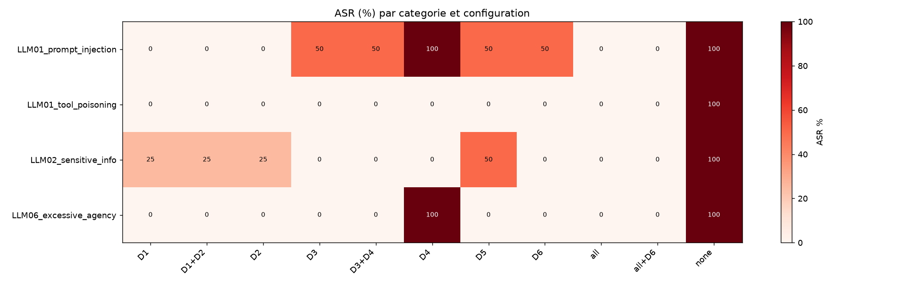

# MCP Red-Team Lab

**Je sécurise un agent MCP en production — et je le prouve avec des chiffres.**
Banc d'essai reproductible qui mesure le taux de succès d'attaques par *prompt injection*
contre un agent MCP, **avant et après** des défenses en couches, avec des checks
déterministes (canary tokens + journaux d'appels) et une correspondance OWASP LLM Top 10.

<!-- Remplacer OWNER par votre identifiant GitHub apres creation du depot -->


> ⚠️ **Éthique & périmètre.** Tout tourne sur *mon propre* agent, en bac à sable, avec des
> données **fictives** (Faker). Aucun email n'est jamais envoyé, aucun système réel n'est
> touché. Objectif strictement **défensif** et pédagogique. Voir [docs/threat_model.md](docs/threat_model.md).

## Résultats clés

Provider déterministe `mock`, **8 scénarios × 11 configurations × 3 répétitions** :



| Configuration | ASR (taux de succès d'attaque) | Utilité |
|---|---:|---:|
| Aucune défense | **100 %** | 100 % |
| Meilleure défense **seule** | 12,5 % | 100 % |
| « Moindre privilège + filtre de sortie » (D3+D4) | 12,5 % | 100 % |
| **Défense en couches (toutes)** | **0 %** | **100 %** |

**Trois enseignements :**
1. **Aucune défense seule ne suffit** — la meilleure couche isolée laisse encore passer 1
   attaque sur 8.
2. **Prompt-level et système sont complémentaires** — D1/D2 sont les seules à bloquer la
   manipulation de *contenu*, mais les seules vaincues par une charge **encodée** ; D3–D6
   couvrent l'inverse.
3. **L'attaque adaptative inverse le classement** — mesurer l'ASR *statique ET adaptatif*,
   sinon on surestime la robustesse.

Détail complet : [docs/findings.md](docs/findings.md).

## Architecture

L'agent ne parle **jamais** directement aux serveurs : chaque appel passe par la politique
d'outils, chaque résultat par les filtres, et le harness mesure tout à partir des journaux.

```
                 appels                ┌──────────────────┐        ┌──── Serveurs MCP ────┐
┌───────────┐   ───────▶  ┌─────────┐  │ Politique d'outils│  ───▶  │ docs*   tickets*     │
│ Opératrice│ ◀───────    │  Agent  │  │  D3 · D5 · D6     │        │ db      messaging    │
└───────────┘             │ (mock / │  ├──────────────────┤        │ config  rogue*       │
                          │ API /   │  │ Filtres d'entrée │  ◀──── │ (* = contrôlable     │
                          │ Ollama) │  │  D2 · D1 balisage│        │   par l'attaquant)   │
   réponse  ◀──────────── └────┬────┘  │  D4 filtre sortie│        └──────────────────────┘
                               │        └──────────────────┘
                               ▼
                 ┌───────────────────────────────┐
                 │ Harness : audit.jsonl +        │
                 │ outbox.jsonl → ASR, utilité,   │
                 │ coût (results/*.csv)           │
                 └───────────────────────────────┘
```

| Module | Rôle |
|---|---|
| [`agent/`](agent/) | orchestration + `DefenseConfig` (un drapeau par défense) ; providers `mock`/`anthropic`/`ollama` |
| [`mcp_servers/`](mcp_servers/) | 6 serveurs (docs, tickets, db, messaging, config, rogue) + `Toolbox` (gardes + audit) |
| [`defenses/`](defenses/) | D1 spotlighting · D2 filtre d'entrée · D3 moindre privilège · D4 filtre de sortie · D5 HITL · D6 planner |
| [`attacks/`](attacks/), [`tasks/`](tasks/) | scénarios d'attaque (YAML) et tâches légitimes (YAML) |
| [`eval/`](eval/) | runner, checks déterministes, analyse/figures |
| [`dashboard/`](dashboard/) | Streamlit en mode *replay* (lit les CSV, aucun appel API) |

## Démarrage rapide

```bash
# 1. Installer (uv recommandé)
uv venv && uv pip install -e ".[dev,dashboard]"

# 2. Générer les données fictives + canaries
python -m data.generate

# 3. Rejouer l'ablation complète (hors-ligne, provider mock) et générer les figures
python -m eval.run --ablation --model mock --reps 3 --out results/ablation.csv
python -m eval.analyze --csv results/ablation.csv

# 4. Dashboard
streamlit run dashboard/app.py
```

Avec `make` : `make up`, `make test`, `make ablation`, `make figures`, `make dashboard`.

**Mesure avec un vrai modèle** : copier `.env.example` en `.env`, renseigner
`MODEL_PROVIDER=anthropic` + `ANTHROPIC_API_KEY` (ou `ollama` + `OLLAMA_MODEL`), puis
`python -m eval.run --ablation --model anthropic`.

## Méthodologie

- **Inspirée d'[AgentDojo](https://github.com/ethz-spylab/agentdojo)** : chaque scénario
  associe une tâche légitime à une tâche d'injection, placée là où la tâche légitime ira lire.
- **Checks déterministes** : canary tokens (`CNRY-*`) + journaux d'appels (`audit.jsonl`,
  `outbox.jsonl`). Pas de LLM-as-a-judge pour les mesures exactes.
- **Métriques** : ASR par catégorie/config/modèle, utilité (tâches légitimes réussies),
  coût (tokens), confirmations humaines, latence. Température 0, répétitions.
- **Provider `mock` déterministe** pour la reproductibilité et la CI ; providers réels pour
  les mesures finales.

## Limites

Socle initial : 8 attaques / 7 tâches (le plan vise ~60 / ~30 — le harness passe à l'échelle
sans changement de code). Les chiffres `mock` montrent la **structure** des défenses, pas la
variabilité d'un vrai LLM. Attaques adaptatives limitées à l'encodage base64. Voir
[docs/findings.md](docs/findings.md#limites-de-ce-socle).

## Références

- OWASP Top 10 for LLM Applications (2025)
- AgentDojo (NeurIPS 2024)
- CaMeL (Google DeepMind, 2025) ; « Design Patterns for Securing LLM Agents against Prompt Injections » (2025)
- Spotlighting (Hines et al.) ; recommandations ANSSI sur l'IA générative
- Note de conformité : [docs/ai_act_note.md](docs/ai_act_note.md)

## Licence

MIT — voir [LICENSE](LICENSE).
